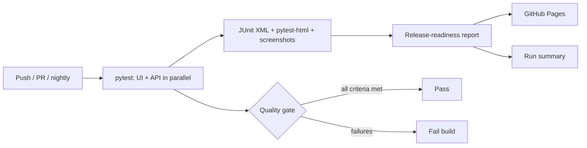

# SDET Automation Framework

[](https://github.com/artysficial/sdet-automation-framework/actions/workflows/tests.yml)
[](https://artysficial.github.io/sdet-automation-framework/)


A production-style test automation framework spanning a web storefront, an online bank, two REST APIs and a
security suite, built the way I build them for banking and payment-security clients: behaviour written as BDD
scenarios that stakeholders can review, page objects and API clients underneath, CI on every change and nightly,
and a **release-readiness report** that turns raw results into a Go / No-go recommendation.

**[View the latest release-readiness report →](https://artysficial.github.io/sdet-automation-framework/)**

| | |
|---|---|
| **Systems under test** | [Sauce Demo](https://www.saucedemo.com) storefront, [ParaBank](https://parabank.parasoft.com) online bank (UI + REST), [restful-booker](https://restful-booker.herokuapp.com) and the [YouTube Data API](https://developers.google.com/youtube/v3); all public apps for automation or security practice |
| **Security** | OWASP-aligned SQLi, XSS, access-control and security-header checks, with [OWASP Juice Shop](https://owasp.org/www-project-juice-shop/) as an intentionally-vulnerable reference target (see [SECURITY_TESTING.md](docs/SECURITY_TESTING.md)) |
| **Stack** | Python 3.11, pytest, pytest-bdd (Gherkin), Selenium 4, requests, JSON Schema, pytest-xdist, pytest-html |
| **CI/CD** | GitHub Actions: every push and pull request, nightly at 08:00 WIB, Juice Shop as a Docker service, reports published to GitHub Pages |
| **Coverage** | 62 tests across banking, storefront, APIs and security; BDD UI, REST contract and OWASP-aligned checks |
| **Defects found** | [6 logged defects](docs/DEFECTS.md), including a customer-facing price shown as `$59.980000000000004` and two missing security headers |

## What this demonstrates

- **BDD that stakeholders can read.** UI behaviour lives in [Gherkin feature files](tests/ui/features/); step
  definitions are thin and call page objects, so a redesign changes locators, not scenarios.
- **Financial correctness checks.** Order totals are verified to the cent with `Decimal` arithmetic across baskets of
  1, 2 and 6 items: item total equals the sum of lines, tax is 8%, total equals item total plus tax.
- **A security suite, defensively.** OWASP-aligned checks (SQLi, XSS, broken access control, security headers) verify
  that protections hold on the banking and API targets, with OWASP Juice Shop as a known-vulnerable reference that
  proves each detector actually catches a real finding. Detection-level and non-destructive — see
  [SECURITY_TESTING.md](docs/SECURITY_TESTING.md).
- **API breadth.** REST contract tests (JSON Schema), banking REST, and the YouTube Data API (which skips cleanly
  when no API key is configured and runs in CI from a secret).
- **Known-defect discipline.** Each logged defect has an automated reproduction that runs as a *strict* expected
  failure: if a defect is quietly fixed, the build turns red so it is re-verified and closed, not forgotten.
- **Evidence by default.** Failures and known defects capture a screenshot and page URL into the detailed report.
- **Reporting for decision makers.** [`tools/readiness_report.py`](tools/readiness_report.py) evaluates exit criteria
  and publishes a recommendation, open defects and results by area. The same summary appears on each GitHub Actions run.
- **Parallel and deterministic.** Tests run four-wide with xdist; every test creates its own data and cleans up after itself.

## Pipeline



## Project structure

```
config/settings.py            environment-driven configuration
framework/
  driver_factory.py           Chrome session setup (Selenium Manager resolves the driver)
  pages/                      storefront page objects + parabank/ banking page objects
  api/                        clients: restful-booker, ParaBank, YouTube; test-data builders
  schemas/                    JSON Schemas for contract checks
  security/                   non-destructive detection payloads and helpers
tests/
  ui/features/*.feature       Gherkin scenarios (storefront + ParaBank)
  ui/*.py                     step definitions
  api/                        restful-booker, ParaBank and YouTube API tests
  security/                   SQLi, XSS, access-control and security-header checks
tools/readiness_report.py     JUnit XML -> release-readiness report
docs/TEST_STRATEGY.md         scope, risks, entry and exit criteria
docs/SECURITY_TESTING.md      authorization boundary and OWASP coverage
docs/DEFECTS.md               defect log with reproduction steps
.github/workflows/tests.yml   CI pipeline (Juice Shop service, Pages publish)
```

## Running locally

```bash
python -m venv .venv
.venv\Scripts\activate          # macOS/Linux: source .venv/bin/activate
pip install -r requirements.txt

pytest                          # full suite, headless, 4 workers
pytest -m smoke                 # release-gate subset
pytest -m security              # OWASP-aligned checks
pytest -m "api and not known_defect"
pytest tests/ui --headed -n 0   # watch the browser, one worker

python tools/readiness_report.py reports/junit.xml --out reports/index.html
```

Reports are written to `reports/`: `index.html` (readiness), `detailed-report.html`, `junit.xml` and `screenshots/`.
Base URLs, timeouts and credentials can be overridden with environment variables (see
[`config/settings.py`](config/settings.py)). Two optional targets are gated:

- **OWASP Juice Shop** (security reference): the Juice Shop tests skip unless `JUICE_SHOP_URL` is reachable.
  Run it locally with `docker run --rm -p 3000:3000 bkimminich/juice-shop`; CI starts it as a service container.
- **YouTube Data API**: those tests skip unless `YOUTUBE_API_KEY` is set (a free key from console.cloud.google.com).
  In CI it is read from the `YOUTUBE_API_KEY` repository secret.

## Documentation

- [Test strategy](docs/TEST_STRATEGY.md): scope, risk-based priorities, entry and exit criteria
- [Security testing](docs/SECURITY_TESTING.md): authorization boundary and OWASP coverage
- [Defect log](docs/DEFECTS.md): six defects with steps to reproduce, severity and impact

## Author

**Rahmadani Tyas Ningrum**, Test Lead and Senior Automation SDET for banking and payment-security technology.
[Portfolio](https://artysficial.github.io/) · [LinkedIn](https://www.linkedin.com/in/rahmadani-t-747a77186) ·
[artysficial@gmail.com](mailto:artysficial@gmail.com)

This is an independent portfolio project. It is not affiliated with Sauce Labs, Parasoft, the restful-booker or
OWASP Juice Shop projects, or Google. All security testing targets authorized, intentionally-public practice
applications only (see [SECURITY_TESTING.md](docs/SECURITY_TESTING.md)); it contains no client or employer code or data.
