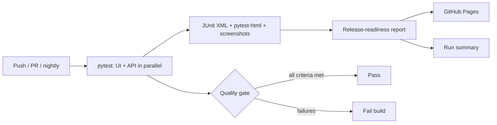

# SDET Automation Framework

[](https://github.com/artysficial/sdet-automation-framework/actions/workflows/tests.yml)
[](https://artysficial.github.io/sdet-automation-framework/)


A production-style test automation framework for a web storefront and a REST API, built the way I build them for
banking and payment-security clients: behaviour written as BDD scenarios that stakeholders can review, page objects
and API clients underneath, CI on every change and nightly, and a **release-readiness report** that turns raw results
into a Go / No-go recommendation.

**[View the latest release-readiness report →](https://artysficial.github.io/sdet-automation-framework/)**

| | |
|---|---|
| **Systems under test** | [Sauce Demo](https://www.saucedemo.com) e-commerce storefront (UI) and [restful-booker](https://restful-booker.herokuapp.com) booking service (API), both public apps published for automation practice |
| **Stack** | Python 3.11, pytest, pytest-bdd (Gherkin), Selenium 4, requests, JSON Schema, pytest-xdist, pytest-html |
| **CI/CD** | GitHub Actions: every push and pull request, nightly at 08:00 WIB, reports published to GitHub Pages |
| **Coverage** | 34 tests: sign-in, catalogue, cart, checkout and order pricing; booking lifecycle, authorisation, contract and error handling |
| **Defects found** | [4 logged defects](docs/DEFECTS.md), including a customer-facing price shown as `$59.980000000000004` |

## What this demonstrates

- **BDD that stakeholders can read.** UI behaviour lives in [Gherkin feature files](tests/ui/features/); step
  definitions are thin and call page objects, so a redesign changes locators, not scenarios.
- **Financial correctness checks.** Order totals are verified to the cent with `Decimal` arithmetic across baskets of
  1, 2 and 6 items: item total equals the sum of lines, tax is 8%, total equals item total plus tax.
- **Security-minded API testing.** Every write operation is attempted without authorisation, and the record is then
  re-read to prove it did not change. Payloads are validated against a [JSON Schema](framework/schemas/booking.schema.json).
- **Known-defect discipline.** Each logged defect has an automated reproduction that runs as a *strict* expected
  failure: if a defect is quietly fixed, the build turns red so it is re-verified and closed, not forgotten.
- **Evidence by default.** Failures and known defects capture a screenshot and page URL into the detailed report.
- **Reporting for decision makers.** [`tools/readiness_report.py`](tools/readiness_report.py) evaluates exit criteria
  and publishes a recommendation, open defects and results by area. The same summary appears on each GitHub Actions run.
- **Parallel and deterministic.** Tests run four-wide with xdist; every test creates its own data and cleans up after itself.

## Pipeline



## Project structure

```
config/settings.py            environment-driven configuration
framework/
  driver_factory.py           Chrome session setup (Selenium Manager resolves the driver)
  pages/                      page objects: login, inventory, cart, checkout
  api/                        restful-booker client and test-data builders
  schemas/                    JSON Schemas for contract checks
tests/
  ui/features/*.feature       Gherkin scenarios
  ui/conftest.py              step definitions
  api/test_booking_api.py     API tests
tools/readiness_report.py     JUnit XML -> release-readiness report
docs/TEST_STRATEGY.md         scope, risks, entry and exit criteria
docs/DEFECTS.md               defect log with reproduction steps
.github/workflows/tests.yml   CI pipeline
```

## Running locally

```bash
python -m venv .venv
.venv\Scripts\activate          # macOS/Linux: source .venv/bin/activate
pip install -r requirements.txt

pytest                          # full suite, headless, 4 workers
pytest -m smoke                 # release-gate subset
pytest -m "api and not known_defect"
pytest tests/ui --headed -n 0   # watch the browser, one worker

python tools/readiness_report.py reports/junit.xml --out reports/index.html
```

Reports are written to `reports/`: `index.html` (readiness), `detailed-report.html`, `junit.xml` and `screenshots/`.
Configuration such as base URLs and timeouts can be overridden with environment variables (see
[`config/settings.py`](config/settings.py)).

## Documentation

- [Test strategy](docs/TEST_STRATEGY.md): scope, risk-based priorities, entry and exit criteria
- [Defect log](docs/DEFECTS.md): four defects with steps to reproduce, severity and impact

## Author

**Rahmadani Tyas Ningrum**, Test Lead and Senior Automation SDET for banking and payment-security technology.
[Portfolio](https://artysficial.github.io/) · [LinkedIn](https://www.linkedin.com/in/rahmadani-t-747a77186) ·
[artysficial@gmail.com](mailto:artysficial@gmail.com)

This is an independent portfolio project. It is not affiliated with Sauce Labs or the restful-booker project, and it
contains no client or employer code or data.
